<!-- ============================== HEADER ============================== --> <div align="center">  <a href="https://git.io/typing-svg">  </a> <br/>
<a href="https://www.linkedin.com/in/miguelaraujodev"></a> <a href="mailto:miguelaraujoaraujo01@gmail.com"></a> <a href="https://github.com/thearaujodev?tab=followers"></a> 

</div>

---
## 👨🏽‍💻 Sobre mim

```python
class MiguelAraujo:
    def __init__(self):
        self.cargo     = "Aprendiz de Operações & Implantação @ Autopass"
        self.formacao  = "Análise e Desenvolvimento de Sistemas @ FMU"
        self.local     = "São Paulo, Brasil"
        self.foco      = ["Backend", "Automação", "Dados", "Full-Stack"]
        self.stack     = ["Python", "JavaScript", "SQL"]

    def mindset(self) -> str:
        return "build → learn → improve → repeat"
```

Sou estudante de **Análise e Desenvolvimento de Sistemas** e trabalho na operação de bilhetagem da **Autopass**. Gosto de entender o problema antes da ferramenta: o que me move é transformar processos manuais e repetitivos em software simples, confiável e fácil de manter.

- 🔭 Construindo o **[Sauday](https://github.com/thearaujodev/sauday)** para o FMU Tech Inovação 2026.2 (ODS 3 — Saúde e Bem-Estar)
- ⚙️ No dia a dia, atendo chamados de suporte à bilhetagem (N1/N2) no TOPdesk seguindo ITIL e acompanho implantações em empresas parceiras
- 🤖 Próximo passo: automatizar processos internos da operação com Python e SQL
- 🌱 Aprofundando em **APIs REST, Node.js, POO e modelagem de bancos relacionais**
- 💬 Pode falar comigo sobre **Python, Flask, SQL, Excel e Power BI**

---
## 🛠️ Tecnologias

<table> <tr> <td align="center" width="140"><b>Linguagens</b></td> <td></td> </tr> <tr> <td align="center"><b>Backend</b></td> <td></td> </tr> <tr> <td align="center"><b>Bancos de dados</b><td>
      
      
    </td> </tr> <tr> <td align="center"><b>Ferramentas</b></td> <td></td> </tr> <tr> <td align="center"><b>Dados</b></td> <td>   </td> </tr> </table>

---
## 🚀 Projetos em destaque

<table> <tr> <td width="50%" valign="top"> <h3>💚 <a href="https://github.com/thearaujodev/sauday">Sauday</a></h3> <p>Plataforma web para organizar consultas, exames e vacinas, com <b>lembretes automáticos</b> antes de cada compromisso. API REST em Flask, serviço de lembretes independente e central de avisos com garantia de <b>aviso único</b> por lembrete (atualização atômica no banco).</p> <p>🏆 FMU Tech Inovação 2026.2 · ODS 3</p> <p>     </p> <p></p> </td> <td width="50%" valign="top"> <h3>🌎 <a href="https://github.com/thearaujodev/LocalizaRecicla">LocalizaRecicla</a></h3> <p>Plataforma web para o descarte correto de resíduos em São Paulo. Encontra <b>ecopontos próximos</b> por geolocalização ou bairro, filtra por tipo de material e abre a rota no Google Maps. Base com <b>80 ecopontos reais</b> servida por API própria.</p> <p>🎓 Projeto acadêmico · 1º semestre de ADS</p> <p>     </p> <p></p> </td> </tr> </table>

---
## 📊 Estatísticas

<div align="center">   

<br/><br/>

<picture> <source media="(prefers-color-scheme: dark)" srcset="https://raw.githubusercontent.com/thearaujodev/thearaujodev/output/github-snake-dark.svg" /> <source media="(prefers-color-scheme: light)" srcset="https://raw.githubusercontent.com/thearaujodev/thearaujodev/output/github-snake.svg" />  </picture> </div>
<!-- ============================== FOOTER ============================== --> <div align="center">
 
 </div>
